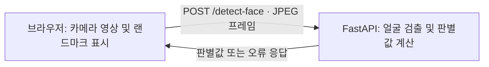

# Face Frontal Detection

## 프로젝트 개요
- 얼굴 정면 감지를 수행하는 API
- FastAPI와 Dlib을 사용하여 얼굴 정면 여부를 판별
- JavaScript 기반 프론트엔드와 연동

## 기술 스택
- **Frontend**: Vanilla JS, Vite
- **Backend**: FastAPI, Python, Dlib, OpenCV

## 프로젝트 구조

```text
apps/
├── web/
│   ├── index.html           # 시작 화면
│   ├── camera.html          # 카메라 및 판별 안내 화면
│   ├── src/pages/           # 화면, 카메라, 판별 요청 및 안내 로직
│   └── public/models_ai/    # 브라우저용 얼굴 검출 모델 파일
└── api/
    ├── app/
    │   ├── main.py          # FastAPI 애플리케이션 진입점
    │   ├── routers/         # 얼굴 판별 API
    │   ├── services/        # 얼굴 검출과 판별값 계산
    │   └── assets/models/   # 다운로드한 dlib 모델 저장 위치
    ├── scripts/download_models.py
    └── requirements.txt
```

## 로컬 실행

아래 명령은 **macOS 기준**입니다. 터미널을 저장소 최상위 폴더에서 열어 시작합니다.

### 사전 요구사항

- Node.js 20 및 npm — 개발 환경에서 Node.js `20.19.3` 사용
- Python 3.11
- `dlib`을 소스에서 빌드하는 환경이라면 CMake와 C++ 컴파일러가 필요합니다.
- 의존성 설치, 백엔드 모델 다운로드, 브라우저에서 사용하는 face-api.js CDN 로딩에 인터넷 연결이 필요합니다.

### 최초 1회 준비

**터미널 A — 백엔드**

```bash
cd apps/api
python3.11 -m venv .venv
source .venv/bin/activate
python -m pip install -r requirements.txt
python scripts/download_models.py
```

백엔드의 dlib 모델은 Git에 포함되지 않습니다. 다운로드 스크립트를 실행하면 `apps/api/app/assets/models/shape_predictor_68_face_landmarks.dat`가 준비됩니다.

**터미널 B — 프론트엔드**

저장소 최상위 폴더에서 새 터미널을 엽니다.

```bash
cd apps/web
npm ci
```

프론트엔드의 모델 파일은 `apps/web/public/models_ai/`에 포함되어 있어 별도로 다운로드할 필요가 없습니다. 기본 로컬 실행에서는 `apps/web/.env.development`의 `VITE_API_BASE_URL`을 사용하므로 루트에 `.env` 파일을 만들 필요가 없습니다.

### 매번 실행

**터미널 A — 백엔드**

저장소 최상위 폴더에서 시작하는 경우:

```bash
cd apps/api
source .venv/bin/activate
python -m uvicorn app.main:app --reload --host 127.0.0.1 --port 8000
```

이미 `apps/api`에 있다면 `cd` 줄은 건너뜁니다. 서버가 모델을 상대 경로로 읽으므로 `apps/api`에서 실행합니다.

**터미널 B — 프론트엔드**

저장소 최상위 폴더에서 시작하는 경우:

```bash
cd apps/web
npm run dev
```

이미 `apps/web`에 있다면 `cd` 줄은 건너뜁니다. 두 서버를 실행한 채 Chrome에서 `http://localhost:5173/`을 열고 **시작하기**를 눌러 카메라 권한을 허용합니다.

### 동작 확인

1. 카메라 영상과 얼굴 랜드마크가 표시되는지 확인합니다.
2. Chrome DevTools의 Network에서 `POST /detect-face`의 **Request URL**이 `http://localhost:8000/detect-face`인지 확인합니다.
3. 얼굴을 화면 중앙에 두고 정면을 유지했을 때 `200` 응답이 들어오고 화면에 **정면 인식 완료**가 표시되는지 확인합니다.

영상이 보이더라도 API 연결이나 서버 판별이 정상이라는 뜻은 아닙니다. 요청 주소·응답 상태와 화면의 완료 안내를 각각 확인합니다.

### 실행이 안 될 때

- **백엔드에서 모델 파일을 찾지 못함:** `apps/api`에서 실행했는지, 모델 다운로드 스크립트를 실행했는지 확인합니다.
- **Vite가 `5174` 등 다른 포트로 시작됨:** 로컬 API의 CORS 허용 목록에 `http://localhost:5173`이 설정되어 있습니다. `5173`을 사용하는 기존 개발 서버를 종료하고 프론트를 다시 실행합니다.
- **카메라 영상이 표시되지 않음:** 브라우저에서 이 사이트의 카메라 권한을 허용한 뒤 새로고침합니다.
- **`400 No face detected` 응답:** 서버가 받은 프레임에서 얼굴을 찾지 못했다는 뜻입니다. 얼굴이 화면 중앙에 잘 보이도록 한 뒤 다시 확인합니다.

## 아키텍처



브라우저는 카메라 영상에서 랜드마크를 표시하고 JPEG 프레임을 서버로 보냅니다. 서버는 프레임에서 얼굴을 검출하고 방향 판별에 필요한 값을 반환합니다. 브라우저는 응답을 바탕으로 방향 안내, 정면 완료 또는 실패 안내를 표시합니다.